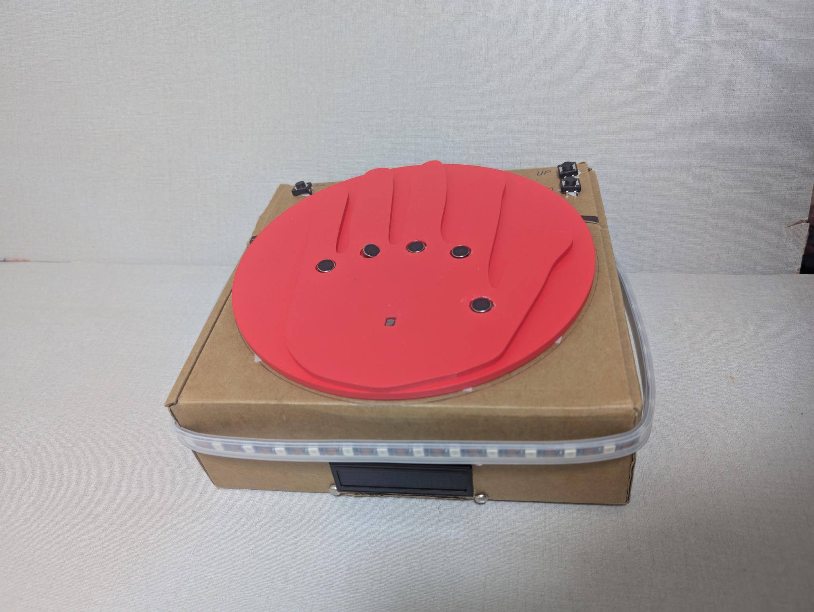
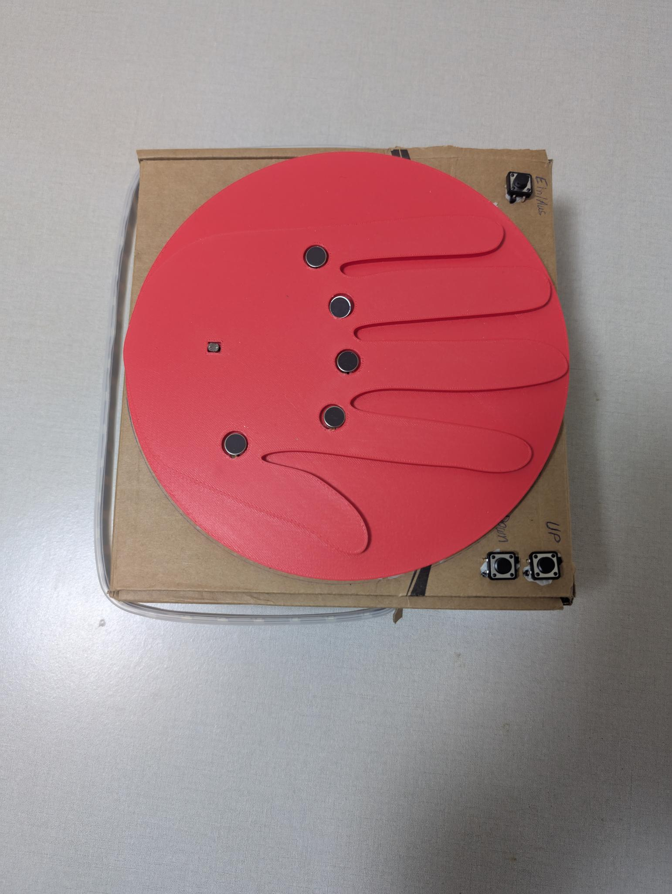
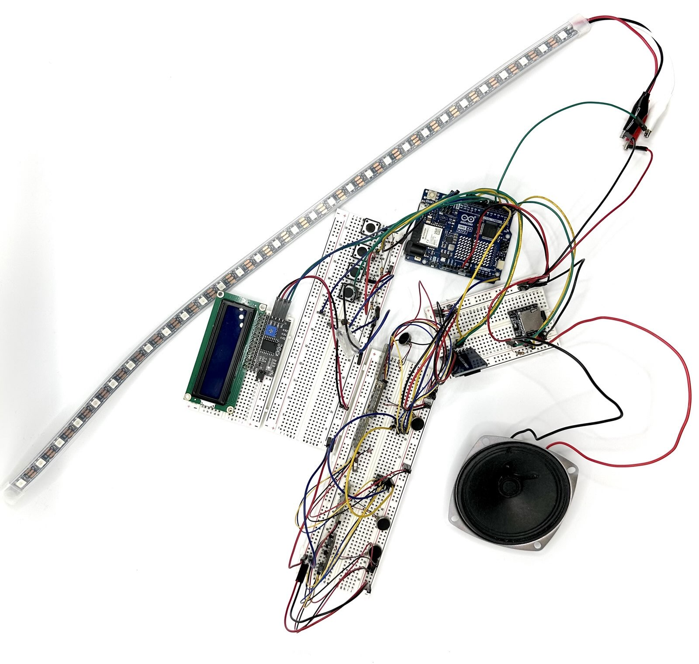
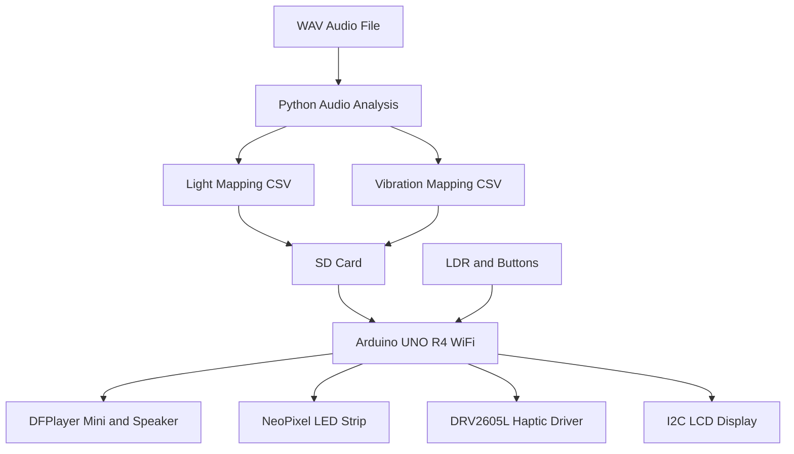

# Feel the Music – Arduino Interactive Music Prototype

An interactive hardware prototype that makes music **audible, visible, and tangible** through MP3 playback, synchronized LED lighting, and haptic feedback.

Built with **Arduino UNO R4 WiFi, C++, Python, NeoPixel LEDs, a DFPlayer Mini, and an Adafruit DRV2605L haptic driver**.

The project combines embedded programming, sensor-based interaction, and offline audio analysis to translate music into coordinated light and vibration effects.



**Project:** Feel the Music  
**Context:** Prototyping Interactive Objects, Summer Semester 2025  
**Team:** Omar Assad Salem and Tarek Wais  
**Institution:** Hochschule RheinMain

[Watch the demo video](https://waistarek.github.io/feel-the-music-arduino/) · [Detailed project documentation (German)](fuehleDieMusikDoku.md)

## Project Overview

Feel the Music explores a multisensory way of experiencing music.

The prototype combines three output channels:

- **Sound:** MP3 playback through a DFPlayer Mini and speaker.
- **Light:** Addressable NeoPixel LEDs display time-based color effects.
- **Touch:** A vibration motor controlled by the DRV2605L provides haptic feedback.

A light-dependent resistor (LDR) detects changes in brightness and can trigger playback when the sensor is covered.

A 16×2 LCD displays the current song, while physical buttons provide power and song-selection controls.

Instead of analyzing audio in real time on the Arduino, the system uses **Python scripts to analyze WAV files beforehand**. The generated CSV files define when lighting and vibration events should occur.

The Arduino loads these mappings from an SD card and executes them using a shared timing reference.

## Features

- MP3 playback with the DFPlayer Mini
- Sensor-based activation using an LDR
- Physical on/off and song-selection buttons
- 16×2 LCD with song information
- Individually addressable NeoPixel LED strip
- Haptic feedback through the DRV2605L driver
- Time-based light and vibration mappings
- WAV audio analysis using Python, Librosa, and NumPy
- Automatic mapping-file generation for individual songs
- Modular Arduino/C++ implementation

## Hardware Prototype

### Completed Prototype



The finished prototype uses a cardboard enclosure with a red hand-shaped surface, physical control buttons, an LCD, and an LED strip around the enclosure.

The enclosure was developed as a physical proof of concept for evaluating component placement and user interaction.

### Internal Electronics



The internal electronics were assembled and tested using breadboards and jumper wires.

The development process included earlier buzzer tests, DFPlayer integration, and cardboard enclosure prototypes.

Additional development photographs are available in the [German project documentation](fuehleDieMusikDoku.md).

## System Architecture

The system consists of an offline preprocessing workflow and an Arduino-based playback workflow.



### Audio Processing

The Python preprocessing scripts extract features from WAV files and generate timestamped mappings.

**Light mapping**

`analyze_light_to_csv.py`:

1. Loads an audio file using Librosa.
2. Computes a short-time Fourier transform (STFT).
3. Identifies dominant frequencies.
4. Converts frequencies to colors using HSV-to-RGB mapping.
5. Estimates a brightness factor from spectral values.
6. Writes timestamped RGB events to a CSV file.

**Vibration mapping**

`analyze_bass_to_csv.py`:

1. Loads a WAV file.
2. Extracts spectral energy below a configurable bass-frequency threshold.
3. Identifies events above a percentile threshold.
4. Filters events using minimum time intervals.
5. Writes timestamps and vibration-pattern values to CSV.

The current script writes the constant value `100` for vibration events. The Arduino uses this value as a DRV2605 waveform identifier, not as a calibrated vibration-intensity percentage.

### Arduino Playback

The Arduino application:

1. Initializes the SD module, DFPlayer, LCD, LEDs, vibration driver, and sensor.
2. Loads song information from `songs.txt`.
3. Waits for activation through the power button and LDR.
4. Starts playback and loads the selected song's mapping files.
5. Uses `millis()` to execute scheduled light and vibration events.
6. Resets the shared timing reference when another song is selected.

This approach separates computationally heavier audio preprocessing from the embedded playback system.

## Technology Stack

| Component | Technology |
|---|---|
| Microcontroller | Arduino UNO R4 WiFi |
| Embedded software | Arduino C++ |
| Audio playback | DFPlayer Mini |
| Haptic feedback | Adafruit DRV2605L |
| Lighting | WS2812 / NeoPixel LEDs |
| Display | 16×2 I2C LCD |
| Input | LDR and physical buttons |
| Data storage | SD card and CSV files |
| Audio preprocessing | Python |
| Signal analysis | Librosa and NumPy |
| Data generation | Python CSV module |

## Hardware Components

The documented prototype uses:

- Arduino UNO R4 WiFi
- DFPlayer Mini with speaker
- Adafruit DRV2605L haptic driver and vibration actuator
- WS2812 NeoPixel LED strip
- 16×2 I2C LCD
- Light-dependent resistor (LDR)
- Physical control buttons
- SPI microSD module
- Breadboards and jumper wires
- Suitable power supply

### Important Connections

The current source code uses these pins and interfaces:

| Function | Connection |
|---|---|
| NeoPixel data | D6 |
| SD card chip select | D4 |
| LDR | A0 |
| Power button | D9 |
| Previous song | D8 |
| Next song | D5 |
| DFPlayer | `Serial1` |
| LCD | I2C, address `0x27` |
| DRV2605L | I2C |

The button inputs depend on the physical wiring used in the prototype. The current sketch does not enable internal pull-up resistors for these inputs.

For the hardware assembly and development photographs, refer to [fuehleDieMusikDoku.md](fuehleDieMusikDoku.md).

## Project Structure

```text
feel-the-music-arduino/
├── MusikVibe.ino
├── display_menu.cpp
├── display_menu.h
├── effects_control.cpp
├── effects_control.h
├── ldr_sensor.cpp
├── ldr_sensor.h
├── light_mapping.cpp
├── light_mapping.h
├── sound_to_vibe.cpp
├── sound_to_vibe.h
├── analyze_bass_to_csv.py
├── analyze_light_to_csv.py
├── generate_mappings.py
├── fuehleDieMusikDoku.md
├── docs/
│   ├── index.html
│   └── dfPlayerEinsatz.mp4
├── 01_fertigesProdukt.jpeg
├── 02_fertigesProdukt.jpeg
└── README.md
```

The repository also includes additional development images and an enclosure-concept animation.

**Main modules**

| File | Responsibility |
|---|---|
| `MusikVibe.ino` | Application initialization and main control loop |
| `display_menu.cpp` | LCD output, song selection, MP3 playback |
| `effects_control.cpp` | Shared timing and effect resets |
| `ldr_sensor.cpp` | Light sensing and calibration |
| `light_mapping.cpp` | CSV-driven NeoPixel events |
| `sound_to_vibe.cpp` | CSV-driven haptic events |
| `analyze_bass_to_csv.py` | Bass-event extraction |
| `analyze_light_to_csv.py` | RGB mapping generation |
| `generate_mappings.py` | Runs both analyses and updates song list |

## Getting Started

### Prerequisites

Hardware:

- Arduino UNO R4 WiFi and the documented electronic modules
- Appropriate power connections
- SD storage for mapping files
- A separate microSD card for the DFPlayer, where required by the module

Software:

- Arduino IDE with Arduino UNO R4 board support
- Required Arduino libraries
- Python 3 with Librosa and NumPy
- WAV files for generating mappings
- Corresponding MP3 files for playback

### 1. Clone the Repository

```bash
git clone https://github.com/waistarek/feel-the-music-arduino.git
cd feel-the-music-arduino
```

### 2. Install Python Dependencies

```bash
python -m pip install librosa numpy
```

The repository does not provide a pinned Python dependency file.

### 3. Generate Mapping Files

Run the mapping generator with a three-digit song ID, a WAV file, and the display title.

```bash
python generate_mappings.py 001 song.wav "Example Song"
```

The script generates:

```text
001LT.csv
001V.csv
songs.txt
```

The names are important because the Arduino firmware constructs the mapping filenames from each song ID.

For example:

```text
001LT.csv   # Light events
001V.csv    # Haptic events
001.mp3     # Audio file
```

The generated CSV files contain timestamps in milliseconds.

**Light CSV columns:**

```csv
timestamp,red,green,blue
```

**Vibration CSV columns:**

```csv
timestamp,vibration
```

The Arduino interprets the vibration column as a waveform-pattern value.

### 4. Prepare SD Storage

The Arduino SD module expects these files:

```text
songs.txt
001LT.csv
001V.csv
```

The DFPlayer requires its corresponding MP3 audio file on its own microSD storage.

The main Arduino sketch currently initializes both the SPI SD module and the DFPlayer during startup. It stops initialization if either device is not detected.

Audio files, generated mappings, and `songs.txt` are not included in the repository archive and must be prepared separately.

Use audio material that you are permitted to process and reproduce.

### 5. Prepare the Arduino Environment

Install the Arduino UNO R4 board package and the libraries used by the source code, including:

- Adafruit NeoPixel
- Adafruit DRV2605 Library
- DFRobotDFPlayerMini
- LiquidCrystal_I2C
- SD, SPI, and Wire

Some libraries may require additional dependencies.

The Arduino IDE expects the main `.ino` file to be located in a matching sketch directory.

If necessary, prepare a local sketch folder named `MusikVibe` containing `MusikVibe.ino` and the associated `.cpp` and `.h` files.

Select the appropriate Arduino board and port before compiling and uploading.

The sketch has not been compiled or tested against a specific current library-version combination during this documentation review.

### 6. Operate the Prototype

The intended interaction flow is:

1. Switch the system on using the physical button.
2. Cover the LDR sensor to trigger playback.
3. Listen to the selected MP3.
4. Observe the synchronized LED effects.
5. Experience the scheduled vibration patterns.
6. Use the navigation buttons to change songs.
7. Switch the system off to stop playback and clear the active effects.

The LCD shows the current song title.

## Implementation Details

### Synchronization

The light and vibration controllers maintain independent event lists.

`resetAllEffects()` assigns a shared starting timestamp and resets their event indices.

Both controllers compare their scheduled timestamps against elapsed time from `millis()`.

This provides a common timing reference for the generated events, although exact synchronization with MP3 playback is not measured or guaranteed.

### Event Storage

The current firmware supports:

- Up to 20 song entries in the LCD menu
- Up to 700 loaded light events
- Up to 700 loaded vibration events
- 30 configured NeoPixel LEDs

These are implementation limits, not hardware performance benchmarks.

### LDR Calibration

The LDR module measures initial ambient brightness to establish a reference level.

The current darkness threshold is calculated as a fraction of that reference.

Recalibration is supported after a defined interval when the sensor reading satisfies the recalibration condition.

## Development Process

The project was developed in several stages:

1. **Initial electronics test:** Arduino, breadboard, and buzzer.
2. **Audio integration:** DFPlayer Mini and speaker.
3. **Interactive enclosure:** Cardboard housing with controls and display.
4. **Multisensory output:** NeoPixel LEDs and haptic feedback.
5. **Audio mapping:** Python-generated lighting and vibration sequences.

This iterative approach combined hardware experiments, embedded software, and physical prototyping.

**Demo:** [DFPlayer demonstration video](docs/dfPlayerEinsatz.mp4)

**Further documentation:** [Original German project report](fuehleDieMusikDoku.md)

## Known Limitations

This repository documents a physical prototype rather than a production-ready hardware product.

- Audio analysis is performed offline, not in real time.
- Playback requires correctly prepared external SD-card content.
- The current Arduino sketch requires the DFPlayer and SPI SD module during initialization.
- Exact synchronization with the audio output has not been independently measured.
- The vibration-generation script outputs a fixed waveform-pattern value rather than dynamically calculated vibration intensity.
- The implementation has fixed capacities for songs and scheduled events.
- The provided sketch has not been verified through a current hardware compilation and end-to-end test.
- A complete wiring schematic is not included.
- No automated hardware or integration tests are provided.

## Project Background and Credits

Developed by **Omar Assad Salem and Tarek Wais** as part of the course *Prototyping Interactive Objects*, Summer Semester 2025, at Hochschule RheinMain.

The project demonstrates interdisciplinary prototyping across physical interaction design, embedded systems, sensor integration, and digital signal processing.

### Licensing Note

The repository contains a short MIT license notice, while the original project documentation references CC BY-SA.

The final licensing terms should be clarified with the project contributors before reuse or redistribution is described under a specific license.
